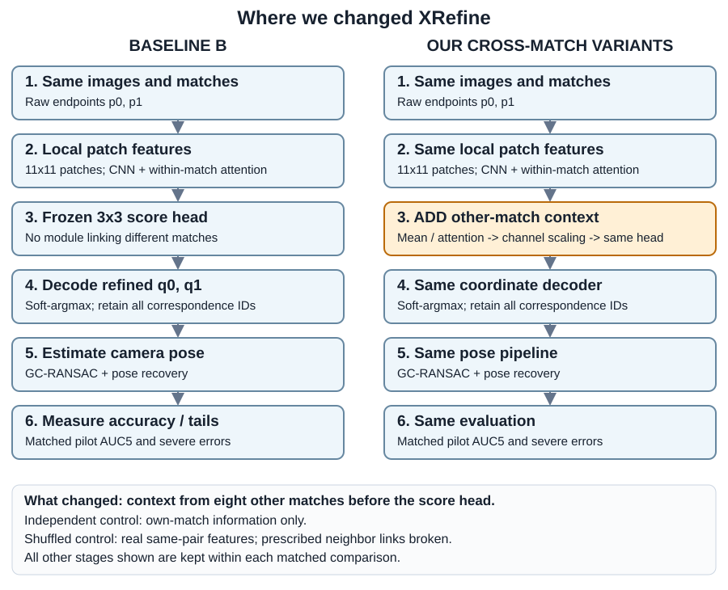

# What we kept, what we changed

These drawings explain historical experiments in the catalogue. Each lane is a separate study or closely related group, not a sequence that combines all the methods. **KEEP** means the corresponding input or operation remains fixed within that study; **CHANGE** marks the tested intervention. Original p denotes acquired coordinates; q denotes frozen Small-refined coordinates.

This documents evaluated, proxy-only or engineering-only work. It proposes no new implementation or scientific run. The main accepted full score remains55.03757; the pilot and proxy outcomes below do not replace it.

## 1. Start with XRefine, then insert cross-match context

The diagram starts from acquired correspondences: shared detection, image preparation and calibration are not expanded. Original Small already exchanges information between the two patches **within one match**. Our extra module exchanges information **between different matches**, after those local features and before the frozen3x3 score head. Mean and attention are separate variants; independent and shuffled controls test the prescribed relationship.

- [Code and actual pilot results](../../experiments/cross-match/README.md)
- [Source-backed interactive-layout SVG](baseline-vs-crossmatch.svg) · [editable workflow](baseline-vs-crossmatch.workflow.json)
- The print version is a readable reflow of the same12nodes and10edges, generated by [render_print_diagram.py](../../tools/render_print_diagram.py). It is a publication derivative, not another Archify validation receipt.

## 2. Change the coordinates passed to the same pose pipeline

Whole-pair benefit/fixed-source readouts, multi-view consensus and recrop consensus alter different coordinate decisions. RM050 branches to a weak-risk screen and stops before pose testing. The old identity-capture recrop diagnostic remains separate from RM051's real pose pilot.

- [Benefit and endpoints](../../experiments/refinement-benefit/README.md) · [multi-view](../../experiments/multi-view/README.md) · [recrop](../../experiments/recrop-consensus/README.md)
- [Editable workflow](coordinate-experiments.workflow.json)

## 3. Change match selection or whole-pose decisions

Selection uses the same acquired population but changes which rows reach the solver. It therefore does not keep every selected count fixed, except where an explicit equal-count control requires it. The medoid operates on saved whole-pose hypotheses. HQ/pixel-metric methods change pose estimation itself and reached engineering smokes, not full evaluations. AR assignment persistence is described in the linked method page alongside the later ranking studies.

- [Verification and coverage](../../experiments/verification-coverage/README.md) · [translation diversity](../../experiments/translation-diversity/README.md) · [pose consensus](../../experiments/pose-consensus/README.md) · [pose updates](../../experiments/uncertainty-and-pose/README.md)
- [Editable workflow](selection-and-pose-experiments.workflow.json)

## 4. Change an uncertainty readout or a generated inference mechanism

The heatmap study leaves weights and coordinates fixed, deriving covariance from the saved3x3 score maps. It evaluates a planar calibration proxy. Bridge BP tests extra image evidence on a generated ambiguity construction. Neither diagram represents a demonstrated natural-image pose gain. Raw3x3 Small maps are retained in the original uncertainty report; these flowcharts show the computation, not a heatmap visualization or an attention-weight map.

- [Uncertainty code and scope](../../experiments/uncertainty-and-pose/README.md) · [generated interaction](../../experiments/generated-interaction/README.md)
- [Editable workflow](proxy-experiments.workflow.json)

## Sources and validation

All four native workflow specifications pin catalogue source revision`dda7c33627903be95a969e1463bbe458500258e3` and cite committed code/protocol lines. Archify3.2 automated validation, delivery, source checks and real-browser checks passed. Native SVG exports and the print layout were visually inspected. Local HTML viewers, browser receipts and raster previews are regenerable and ignored under`.archify/`; the SVG, editable JSON and this scope document are retained.

[Back to catalogue](../../README.md).
