# Three proposed methods to improve XRefine

**Research candidates, not established full-panel gains or original contributions.** Accepted full MegaDepth best remains55.03757AUC5. These are alternatives to test separately, not components already combined or deployed. Geometry-checked actions have qualified in the exposed pilot and are undergoing full evaluation; the other two are unimplemented directions. Their numerical settings, label rules and training configurations are not selected here.

## 1. Geometry-checked endpoint actions — training-free

**Keep:** original acquired p, frozen Small outputs q, every original row and the final pose/evaluation pipeline.

**Change:** fit geometry on two fixed original-ID groups. Score each row's four existing endpoint actions against the opposite group's geometry, selecting both refined, both raw or either mixed pair. Unsupported fold geometry uses exact Small fallback. Ground truth is not a decision input.

**Hypothesis:** fit-excluded geometric context can identify harmful moves better than appearance-only neighbor aggregation. Unlike RM049, this changes endpoint actions rather than removing rows. Cross-fitting, epipolar compatibility and benefit gating are established ideas; wrong coherent geometry can still select wrong actions. Three prepasses add computation.

**First test:** compare baseline, full-fit geometry, action-count-preserving shuffle, raw and halfway controls in the fixed matched32-pair × ten-draw pilot. The saved independent pilot audit returned QUALIFIED_FOR_FULL on the exposed32-pair panel. The full evaluation is underway; a full-panel or independent gain is not yet established. [Detailed frozen proposal and source-backed diagram](crossfold-endpoint-actions.md).

## 2. Adaptive wider-patch evidence — change the available information

**Keep:** the original11x11 frozen Small path and acquired match identities. Do not pass wider tensors into its existing checkpoint.

**Change:** add a separate auxiliary branch that observes a wider patch or outer ring around the same correspondence. Use that extra evidence to decide when to trust Small's coordinate rather than the raw endpoint. This requires separately qualified source and weights if selected; no larger-checkpoint compatibility is assumed.

**Hypothesis:** repeated textures may look identical within small patches but differ in their surroundings. This adds pixels rather than repeating RM051's11x11 recrops. Wider support can also mix surfaces or occlusions, so a gain is uncertain.

**First test:** freeze off-pilot ambiguity cases and test whether outer evidence adds information beyond central-only, shuffled outer evidence and equal-compute controls. A positive generated diagnostic is only headroom, not pose gain. A later learned branch must use matched-capacity controls and a frozen fitting/development protocol before a real pose pilot. Patch size and gating rule remain unselected.

## 3. Visibility-qualified reprojection-benefit supervision — change the target

**Keep:** original Small features/coordinates and the same acquired match population and final pose pipeline.

**Change:** use verified training-only calibrated RGB-D pairs to derive visibility-qualified reprojection references. Label whether each existing raw/refined endpoint action improves reprojection consistency, then train a small separate action head using runtime features. Depth and reference poses are never deployment inputs.

**Hypothesis:** audited reprojection labels may address the along-epipolar ambiguity left by RM050's weak Sampson-risk target. This differs from RM052's first-order pose-loss oracle, which failed its controls. Better reprojection consistency does not guarantee physical localization or pose utility.

**First test:** audit calibration, depth alignment, occlusion, discontinuities, label coverage and image/room-disjoint membership before any training. Depth/pose reprojection is noisy and can miss joint co-drift or repeated-structure identity errors; missing/occluded references stay unknown labels. Preserve prior failed depth qualifications rather than reusing only passing subsets. Suitable labels are not yet qualified: if they cannot be established, this candidate is unavailable. First establish stable held-room action headroom; then compare raw, always-Small, displacement-only and matched-capacity independent/shuffled controls.

## Priority and common qualification

[Full-size candidate diagram](research-candidates.svg) · [Editable workflow](research-candidates.workflow.json). This proposal diagram cites this Markdown at revision022cf6d9; automated Archify validation, delivery, provenance and browser checks passed. It documents ideas, not scientific results.

Finish candidate1's frozen test first. Candidates2/3 are alternatives, not simultaneous launches. Any selected new rule must be frozen away from the pose pilot. Full1500×10 and independent confirmation follow only after fixed accuracy, control, scene/draw and severe-tail gates pass. Report active/fallback coverage and extra compute; do not promote a favorable control or retune a valid negative.

Related primary work includes [ArgMatch](https://openaccess.thecvf.com/content/ICCV2025/html/Deng_ArgMatch_Adaptive_Refinement_Gathering_for_Efficient_Dense_Matching_ICCV_2025_paper.html) on adaptive refinement gating, [Patch2Pix](https://openaccess.thecvf.com/content/CVPR2021/html/Zhou_Patch2Pix_Epipolar-Guided_Pixel-Level_Correspondences_CVPR_2021_paper.html) on patch refinement, and [LoFTR supervision](https://zju3dv.github.io/loftr/files/LoFTR-suppmat.pdf) on depth/pose-based matching labels. These are starting comparisons, not an exhaustive novelty review.

[Back to catalogue](../../README.md).
