# Proposed method: geometry-checked refinement

**Proposal, not an accuracy result.** Prepared source is under engineering qualification; no RM053 pose gain or original contribution is established. The accepted full score remains55.03757 AUC5.

Keep the same acquired matches and frozen Small outputs. Split matches by original row-ID parity. For each row, use geometry fitted on the other group to choose both refined endpoints, both raw endpoints or either mixed pair. Rank the four existing endpoint actions by processed-pixel Sampson residual, preferring normal Small output on a tie. Preserve every row and original coordinate values. If either supplying fold is unsupported, use the normal both-refined whole-pair fallback. No ground truth or learning is used to choose test-time actions.

This tests whether fit-excluded geometric context can reject harmful movements better than appearance-only neighbor mixing. RM049 used related crossfold geometry to select a subset of rows; this proposal instead changes endpoint actions while retaining all matches. Fit exclusion is not statistical independence, and geometrically coherent incorrect matches can still fool the rule. The three full/even/odd prepasses add computation.

Compare unchanged XRefine, the same action rule using full-fit geometry, count-preserving shuffled actions applied to each row's own endpoints, all-raw and halfway coordinates. The frozen32-pair × ten-draw pilot must beat the baseline by at least0.5AUC5, beat all four action controls, improve both scenes and at least8/10global draws, and avoid increased failures or severe errors. Only a qualified pilot can proceed to a separately forecast full evaluation and independent confirmation.

Originality is unestablished. Adaptive refinement gating is related prior art, including [ArgMatch, ICCV2025](https://openaccess.thecvf.com/content/ICCV2025/html/Deng_ArgMatch_Adaptive_Refinement_Gathering_for_Efficient_Dense_Matching_ICCV_2025_paper.html); this is not a claim to have invented gating or cross-fitting.

## Existing proposed-pipeline drawing

[Full-size diagram](crossfold-endpoint-actions.svg) · [Editable Archify source](crossfold-endpoint-actions.json) · [Exact copied-source provenance](source-provenance.json).

The source-backed Archify architecture was drawn and passed automated validation/delivery/check/browser checks before scientific implementation. Its citations identify existing pipeline seams; proposed behavior is not evidence of implementation or accuracy. The SVG and JSON here are exact copies from the authoring worktree, separate from the evaluated experiment catalogue.

[Back to catalogue](../../README.md).
