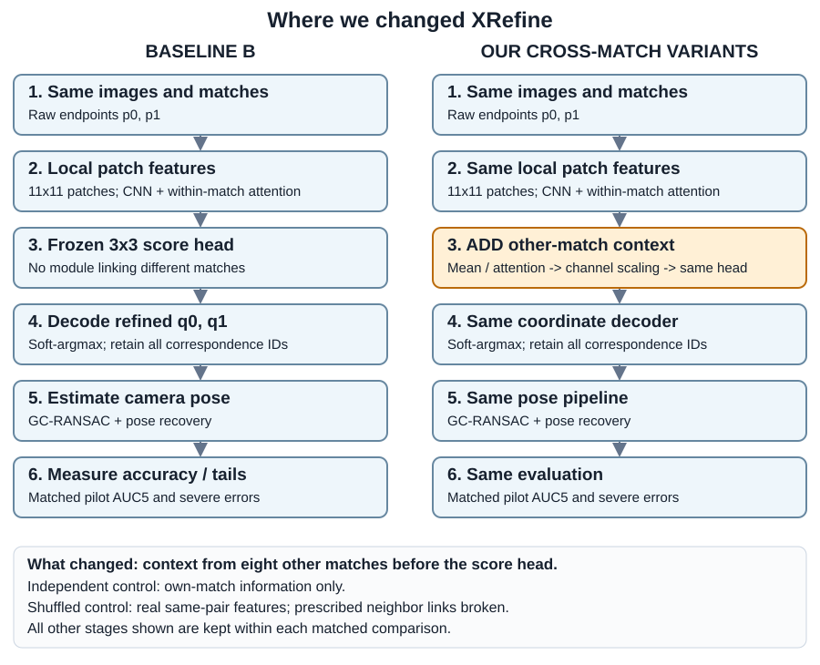

# Cross-match context: mean and learned attention

## Where this changes the pipeline

[Full visual guide and scope](../../docs/diagrams/README.md). Each lane is a separate experiment.

I tested whether information from other matches helps refine the current match.

**Construction.** RM042 averages features from eight spatial neighbors, then applies a learned FiLM modulation before the frozen Small decoder. RM045 replaces that average with four-head attention. Within each study, independent and relationship-shuffled heads match capacity, initialization and training settings. Training used 150 ScanNet FIT pairs for 20 epochs. The decoder and acquired correspondences stayed fixed.

**Outcome: real pose pilot negative.** On 32 exposed MegaDepth pairs × ten fresh draws, mean context scored 44.8857 vs baseline 52.1840; independent 49.6255 and shuffled 49.1566. Attention scored 46.2619 vs baseline 50.0147; independent 48.3787 and shuffled 52.5418. Baselines belong to different fresh runs. Attention shuffle also increased severe errors from 3 to 5 out of 320 and was not promoted.

**Learning.** The prescribed neighbor association added no demonstrated pose benefit. This does not disprove every form of context. Weak supervision, neighbor quality, feature modulation and transfer remain hypotheses rather than isolated causes.

The sibling `crossmatch-042` / `crossmatch-attention-045` names preserve the original local loader relationship. Full pipeline wrappers and learned weights are not bundled.

## Handpicked files

| File | Purpose |
|---|---|
| [crossmatch-042/crossmatch_042.py](crossmatch-042/crossmatch_042.py) | Mean-context graph, feature capture, FiLM, training and prediction |
| [crossmatch-042/test_crossmatch_042.py](crossmatch-042/test_crossmatch_042.py) | Original scientific checks |
| [crossmatch-042/PROTOCOL-042.md](crossmatch-042/PROTOCOL-042.md) | Frozen mean-context protocol |
| [crossmatch-attention-045/attention_045.py](crossmatch-attention-045/attention_045.py) | Learned attention override |
| [crossmatch-attention-045/test_attention_045.py](crossmatch-attention-045/test_attention_045.py) | Affected scientific checks |
| [crossmatch-attention-045/PROTOCOL-045.md](crossmatch-attention-045/PROTOCOL-045.md) | Frozen attention protocol |

Exact original locations, source bindings and hashes are in [PROVENANCE.json](../../PROVENANCE.json). [Back to catalogue](../../README.md).
