# Multi-view coordinate consensus

## Where this changes the pipeline

[Full visual guide and scope](../../docs/diagrams/README.md). Each lane is a separate experiment.

I tested whether the same keypoint's refinements from different partner images can correct each other.

**Construction.** Preparation joins the original keypoint identities and partner-view contexts. Mean, shrinkage, anchored Huber consensus and relationship-shuffled controls combine the saved coordinate evidence while preserving source rows and the evaluation pipeline.

**Outcome: full-panel negative.** On the original1500 directed MegaDepth pairs × ten fresh draws, Huber AUC5 was47.9341 vs matched stock48.3912 (−0.4570). Only2/10 draws improved and both scene means were negative. No independent final-set gain is established.

**Learning.** Agreement across views is not automatically a correction toward physical truth. This closes the tested coordinate-consensus rule, not all uses of multi-view evidence.

The source core, preparation and controls match the full execution freeze. Transport and settlement machinery are omitted.

## Handpicked files

| File | Purpose |
|---|---|
| [multiview_consensus_core.py](multiview_consensus_core.py) | Consensus core or matched control |
| [plugbench_multiview_huber.py](plugbench_multiview_huber.py) | Consensus core or matched control |
| [plugbench_multiview_mean.py](plugbench_multiview_mean.py) | Consensus core or matched control |
| [plugbench_multiview_shrink.py](plugbench_multiview_shrink.py) | Consensus core or matched control |
| [plugbench_multiview_shuffle.py](plugbench_multiview_shuffle.py) | Consensus core or matched control |
| [test_multiview_consensus.py](test_multiview_consensus.py) | Checks |
| [prepare.py](prepare.py) | View/keypoint identity and context preparation |
| [protocol.md](protocol.md) | Frozen protocol |

Exact original locations, source bindings and hashes are in [PROVENANCE.json](../../PROVENANCE.json). [Back to catalogue](../../README.md).
