# Cached pose-hypothesis medoid

## Where this changes the pipeline

[Full visual guide and scope](../../docs/diagrams/README.md). Each lane is a separate experiment.

I tested whether consensus among whole-pose hypotheses is more reliable than taking the first hypothesis.

**Construction.** A fixed three-hypothesis rotational medoid with first-tie handling is compared against FIRST and MAX-original-inlier controls on the same cached pool. RM037 independently reconstructs the saved selections, scalars and gates; no new neural/native fits are implied by the audit.

**Outcome: cached ScanNet negative versus strongest control.** Over300DEV pairs,3000 unique fits and9000 dependent logical readouts: FIRST16.4647, medoid17.0830, MAX17.2633 AUC5. The medoid's gain over FIRST did not beat MAX; no favorable control was promoted and no fresh/full main-panel experiment followed.

**Learning.** Improving a weak baseline is insufficient when a simple stronger same-data control performs better. This is a known ensemble adaptation, not new physical evidence or an established novel contribution.

The RM035 source-a0 files are exact executed archives. RM037's retained `reduce.py` is the independent scalar/selection component; its historical SOURCE ONLY docstring predates the successful saved-data audit.

## Handpicked files

| File | Purpose |
|---|---|
| [rm035/selector_035.py](rm035/selector_035.py) | Whole-pose medoid selector |
| [rm035/test_selector_035.py](rm035/test_selector_035.py) | Checks |
| [rm035/audit_035.py](rm035/audit_035.py) | Saved-data reduction |
| [rm035/protocol.json](rm035/protocol.json) | Frozen scientific settings |
| [rm035/PROTOCOL-035.md](rm035/PROTOCOL-035.md) | Frozen scientific settings |
| [independent-rm037/reduce.py](independent-rm037/reduce.py) | Independent scalar/selection replay |

Exact original locations, source bindings and hashes are in [PROVENANCE.json](../../PROVENANCE.json). [Back to catalogue](../../README.md).
