# Translation-normal diversity (RM049)

## Where this changes the pipeline

[Full visual guide and scope](../../docs/diagrams/README.md). Each lane is a separate experiment.

I tested whether selecting geometrically diverse translation constraints addresses the earlier coverage failures.

**Construction.** Three GT-free prepasses (full/even/odd populations) supply opposite-fold information weights. A normal/eigengap-diversity quota uses reliability gates and exact full-baseline fallback. Confidence-only, equal-count and shuffled controls use the same acquired population and pose pipeline.

**Outcome: pilot negative.** Candidate50.8289 vs fresh baseline52.0771 AUC5; delta−1.2483, descriptive fixed-panel solver-repeat95% interval[−3.6931,+1.1131], only4/10 draws positive and both scenes negative. Four of six gates failed. All pose failures were0.

Only9/32 pairs actively selected;23—including pair38—fell back to full baseline. Severe candidate3 vs baseline7 occurred entirely on unchanged fallback inputs36/13, so it is not demonstrated method tail improvement. C−shuffle−0.1881 with a wide interval does not establish ranking inversion.

**Learning.** The proposed proxy/gates were not enough to produce a pose gain. The variant closed, was reverted, and was not retuned or expanded to full evaluation.

Use the final `attempt-003` source snapshot, not the older top-level archive.

## Handpicked files

| File | Purpose |
|---|---|
| [rm049/verifier.py](rm049/verifier.py) | Evaluated selection logic |
| [rm049/test_verifier.py](rm049/test_verifier.py) | Checks |
| [rm049/PROTOCOL.md](rm049/PROTOCOL.md) | Frozen protocol |

Exact original locations, source bindings and hashes are in [PROVENANCE.json](../../PROVENANCE.json). [Back to catalogue](../../README.md).
