# Uncertainty-aware refinement and pose updates

## Where this changes the pipeline

[Full visual guide and scope](../../docs/diagrams/README.md). Each lane is a separate experiment.

I explored localization uncertainty and downstream pose optimization as separate questions.

**Heatmap uncertainty.** The exact historical `heatmap/study.py` estimates second moments of Small's3×3 score maps, propagates endpoint covariance and checks calibration. The completed HPatches20-pair/2560-match planar proxy failed shape/coverage controls. This is not a real-pose accuracy gain. Scientific entry points include `shapes`, `project`, `propagate`, `quadratic`, `model_actor`, `summarized` and `scalar_audit`.

**RGB context.** `rgb-source-only/rgb_context_v1.py` is a retained callback-bound interface from the closed RGB engineering branch. No successfully scored pose result is asserted.

**Pose updates.** The HQ candidate uses known robust influence/pose ideas; the pixel-metric candidate uses camera-aware pixel-Sampson updates/IRLS/remasking. Their exact numerical candidates reached engineering smokes; full evaluations were blocked by resource admission. They are not completed full scientific negatives.

**Reading scope.** The heatmap study is a monolithic historical controller with original state-writing assumptions: inspect its scientific functions, rather than using it as a standalone launcher. Historical SOURCE/UNTESTED comments in pose candidates predate their later smoke checks and remain byte-exact.

## Handpicked files

| File | Purpose |
|---|---|
| [heatmap/study.py](heatmap/study.py) | Exact historical monolithic study, inspection only |
| [rgb-source-only/rgb_context_v1.py](rgb-source-only/rgb_context_v1.py) | Retained callback-bound RGB context interface, no scored pose result |
| [hq/candidate.py](hq/candidate.py) | Numerical candidate |
| [hq/test_candidate.py](hq/test_candidate.py) | Checks |
| [pixel-metric/candidate.py](pixel-metric/candidate.py) | Numerical candidate |
| [pixel-metric/test_candidate.py](pixel-metric/test_candidate.py) | Checks |

Exact original locations, source bindings and hashes are in [PROVENANCE.json](../../PROVENANCE.json). [Back to catalogue](../../README.md).
